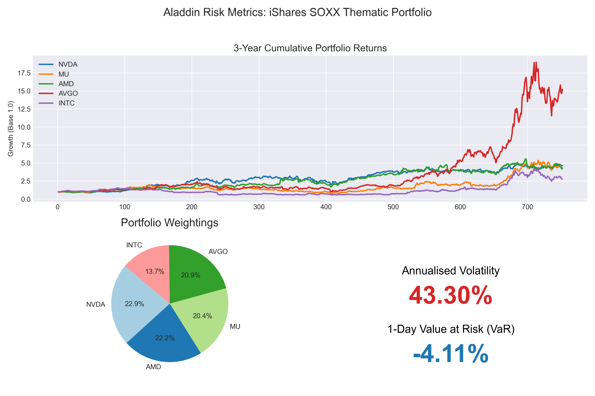

- Project Overview

This project uses Python to build a portfolio risk dashboard inspired by BlackRock's Aladdin platform. Using the top five holdings of the iShares Semiconductor ETF (SOXX), I created a simplified semiconductor portfolio to analyse historical performance, asset allocation, and portfolio-level risk.

The project explores how individual stock returns contribute to overall portfolio performance and how volatility and Value at Risk (VaR) can help assess investment risk.

- Tools and Technologies

Python

Pandas — data handling and preparation

NumPy — portfolio return and risk calculations

Matplotlib — dashboard and data visualisation

Seaborn — chart styling

Jupyter Notebook — analysis workflow

- Methodology

Portfolio construction: Selected five semiconductor stocks and normalised their SOXX holding weights to create a portfolio with a total allocation of 100%.

Portfolio return calculation: Combined individual daily stock returns using the portfolio weights.

Risk analysis: Calculated the covariance matrix, annualised portfolio volatility, and historical 95% one-day Value at Risk.

Visualisation: Built a dashboard combining cumulative stock returns, portfolio allocation, and key risk metrics.

- Key Findings

Annualised portfolio volatility: 43.30%. The portfolio showed substantial historical price variability, reflecting the risk associated with a concentrated semiconductor investment.

Historical 95% one-day VaR: -4.11%. Based on historical daily portfolio returns, the estimated 5th-percentile return was -4.11%.

Concentration risk: A portfolio focused on five semiconductor companies is exposed to company-specific risks and common industry movements.

Performance comparison: The cumulative return chart helps compare the historical growth of the five stocks and identify differences in their performance.

- Dashboard
  

- Project Structure

code.ipynb — Python analysis and dashboard generation.

stock price.xlsx — Input spreadsheet containing historical stock prices and daily returns.

Aladdin_Risk_Dashboard.png — Exported dashboard visualisation.

- Limitations

This is an educational portfolio analysis inspired by institutional risk dashboards, not a replica of BlackRock's Aladdin platform.

The five holdings are rescaled to 100%, so the portfolio represents a simplified portfolio based on SOXX's top holdings rather than the complete ETF.

The analysis uses raw daily closing prices and daily returns rather than adjusted closing prices.

Historical volatility and VaR describe past return behaviour and do not guarantee future performance or maximum losses.

The analysis relies on an input Excel spreadsheet; the notebook does not automatically retrieve live market data.

- Conclusion

This project demonstrates how Python can be used to calculate portfolio-level risk metrics and present investment analysis in a visual dashboard. It strengthened my practical understanding of portfolio weighting, covariance, volatility, historical VaR, and financial data visualisation.# aladdin-inspired-portfolio-risk-dashboard
used Python to build a portfolio risk dashboard inspired by BlackRock's Aladdin platform
